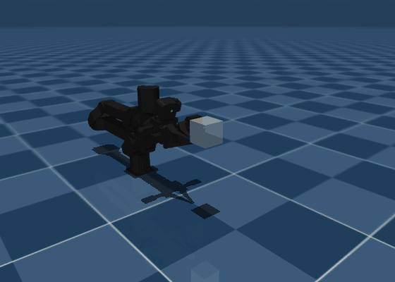
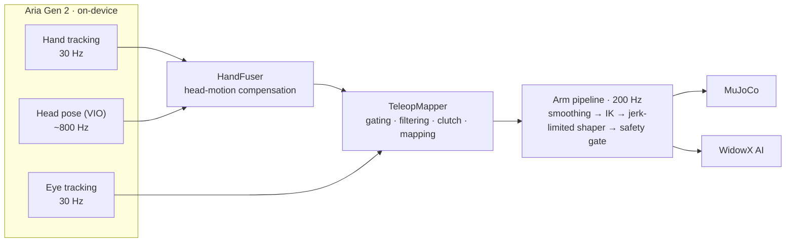

<h1 align="center">aria-teleop</h1>

<p align="center">
  <b>Drive a robot arm with Meta Aria Gen 2 glasses: your hand steers, your eyes are the clutch.</b>
</p>

<p align="center">
  <a href="https://github.com/ApurvK032/aria-teleop/actions/workflows/tests.yml"></a>
  
  <a href="LICENSE"></a>
</p>

<p align="center">
  
</p>

**aria-teleop** teleoperates a [Trossen WidowX AI](https://www.trossenrobotics.com/widowx-ai) arm, in
[MuJoCo](https://mujoco.org) or on hardware, from the sensing that runs *on* the Aria Gen 2 glasses.
There's nothing to hold and nothing to wear on your hands: the glasses track your wrist and fingers,
cancel out your own head motion, and read your eyes, so a deliberate wink starts and stops control.

- **Hands-free input.** On-device hand tracking (30 Hz): the wrist pose steers the gripper, and the
  thumb–index distance opens and closes it. No gloves, controllers or markers.
- **Head-motion compensation.** Every hand frame is placed in the room frame with the glasses' ~800 Hz
  visual-inertial head pose, so looking around doesn't move the robot.
- **Eye-gesture clutch.** Wink left to engage, wink right to release, close both eyes to pause; the
  glasses announce each change. Ordinary blinks are ignored.
- **A real-arm pipeline built for smoothness.** A fixed-rate 200 Hz loop with jerk-limited joint shaping,
  an independent safety gate, slow start-up and shutdown moves, and fault handling.
- **Simulation first.** A scripted mock source, a MuJoCo preview of exactly what the real arm would be
  sent, and a dry run that connects to the arm without moving it.

## Results

From the first session on hardware: Aria Gen 2 over USB, WidowX AI with controller firmware 1.8.3,
at the conservative first-run settings (joints capped at 0.5 rad/s, robot moving at 0.5× the hand).

| | |
|---|---|
| Hand tracking / head pose / eye tracking | 30 Hz / ~800 Hz / 30 Hz, hand confidence ~1.0 |
| Arm vs. its commanded target | median 1.2 mm, 86% of samples within 3 mm, 90th percentile 4 mm; worst 15 mm, while joints were at the speed cap |
| Eye clutch | all 6 winks in the logged real-arm runs acted on (3 engage, 3 release); closed-eye pause and re-anchor checked in the dry run |
| Faults, rejected frames | none |
| Operator's verdict | smooth, with no visible jerks at these settings |

Tracking error is sampled once a second over ~75 s of driving in two logged runs. Not measured yet:
hand-to-robot accuracy against ground truth, end-to-end latency, task success, and behaviour at full
speed and 1:1 scale.

## How it works



| Module | Role |
|---|---|
| [`sources.py`](aria_teleop/sources.py) | `AriaSource` streams hands, head pose, eye tracking and calibration through the Aria Gen 2 Client SDK; `MockSource` fakes them for testing. |
| [`fusion.py`](aria_teleop/fusion.py) | Composes each device-frame hand with the head pose at the same timestamp: `T_room_wrist = T_room_device(t) · T_device_wrist(t)`. |
| [`eyes.py`](aria_teleop/eyes.py) | Debounces per-eye open/closed flags into closure durations. |
| [`mapping.py`](aria_teleop/mapping.py) | Drops low-confidence frames and single-frame glitches, One Euro filtering, the clutch, and relative mapping: when you engage the robot stays put, then copies how your hand moves. |
| [`arm.py`](aria_teleop/arm.py) | The real-arm pipeline: pose smoothing, IK on a kinematic model, a critically damped jerk-limited `JointShaper`, an independent safety gate, and the Trossen driver backend. |
| [`sim.py`](aria_teleop/sim.py) | Trossen's MuJoCo scene and IK controller, the real-time loop, status output and keyboard input. |
| [`hand_viewer.py`](aria_teleop/hand_viewer.py) | Optional [Rerun](https://rerun.io) view of both tracked hands, head pose, confidence and pinch. |

## Installation

Linux (Ubuntu 22.04 / 24.04) with Python 3.10–3.12:

```bash
git clone https://github.com/ApurvK032/aria-teleop.git && cd aria-teleop
python3 -m venv .venv && source .venv/bin/activate
git clone https://github.com/TrossenRobotics/trossen_arm_mujoco.git ../trossen_arm_mujoco
pip install -e ../trossen_arm_mujoco          # must be editable: it carries the IK module
pip install -e ".[aria,test]"                 # add ",arm" for the real arm (trossen-arm driver)
pytest -q
```

One-time setup for the glasses (approve the pairing in the Aria companion app):

```bash
aria_doctor
aria_gen2 auth pair
aria_gen2 device list        # <serial> @ <ip>: use the IP as --device-ip
```

## Quick start

**1. No hardware:** a scripted hand, seen from a deliberately swaying head, drives the simulated arm.

```bash
python -m aria_teleop --source mock                                    # MuJoCo viewer; SPACE engages
python -m aria_teleop --source mock --headless --duration 8 --auto-engage 1
```

**2. With the glasses**, in simulation:

```bash
python -m aria_teleop --source aria --device-ip <GLASSES_IP> --clutch eyes
```

**3. On the real arm.** Follow [docs/real-arm-setup.md](docs/real-arm-setup.md) first (network, limits,
dry run). Then:

```bash
python -m aria_teleop --source aria --device-ip <GLASSES_IP> --clutch eyes --headless \
    --arm real --enable-motion --robot-ip <ROBOT_IP> --arm-max-velocity 0.5 --scale 0.5
```

The settings that felt best so far: `--rotation-scale 0.75 --rotation-deadband 5 --max-angular-speed 2
--pivot-offset 0.156 --pinch-open 0.10`.

## Controls

Keys work in the MuJoCo viewer and in the terminal (the terminal also with `--headless`):

| Key | Action |
|---|---|
| `SPACE` | engage / release the clutch; with `--clutch eyes`, arm / disarm (disarmed, the robot never moves) |
| `H` | reset heading: "forward" is taken from where you face at the next engage |
| `Ctrl+C` | stop; on the real arm it holds, then returns slowly to rest. Press it **once** |

With `--clutch eyes`:

| Gesture | Action |
|---|---|
| wink your left eye (~0.6 s, right eye open) | engage |
| wink your right eye | release |
| close both eyes for longer than a blink (0.5 s) | pause at once; on reopening, the hand re-anchors so motion made without looking is ignored |
| keep both eyes closed for 2 s | release |

`--clutch pinch` makes your other hand a deadman switch instead: pinch it to drive, open it to stop.
Stand behind the arm facing the way it points (or add `--yaw-offset 180` if you face it).

A status line prints once a second. This one is from a real-arm run:

```
[  13.0s] tracking clutch=on  hands 30.0Hz head   796Hz eyes 30.0Hz conf 1.00 pinch  3.9cm target (+0.398,+0.011,+0.081) err   1.3mm joints 0.35/0.50rad/s limit j2  25deg rejected 0 anchors 1
```

## The real arm

`--arm` chooses where joint commands come from and go to:

| `--arm` | What happens |
|---|---|
| `sim` (default) | MuJoCo's own IK drives the simulated arm |
| `preview` | the real-arm pipeline drives the MuJoCo arm: see what the real arm would be sent |
| `dry-run` | connects to the arm and reads its state and limits; computes every command but never sends one |
| `real` | drives the arm; requires `--enable-motion` |

Safety in the pipeline:

- **Version check:** the driver's major.minor must match the controller firmware, or nothing starts.
  An unreachable arm fails within 3 s.
- **Slow transitions:** a slow, blocking move from wherever the arm is to the home pose on start. Exit,
  Ctrl+C or any fault holds the arm, then returns it slowly to rest.
- **Independent gate:** any non-finite, out-of-range or oversized joint command is rejected, separately
  from the shaper that produced it.
- **Tracking fault:** if the arm lags its command by more than 0.12 rad for 50 ms, teleop stops.
- **Speed caps:** joint speeds are capped at `--arm-max-velocity` (default 1 rad/s for the shoulder and
  elbow, 2 for the wrist) and at half of each joint's reported `velocity_max`.

## Options

| Flag | Default | Meaning |
|---|---|---|
| `--source` | `mock` | `mock` or `aria` |
| `--device-ip` | | the glasses' IP (USB discovery is unreliable; pass it) |
| `--clutch` | `key` | `key`, `pinch` or `eyes` |
| `--hand` | `right` | the hand that drives the arm |
| `--scale` | `1.0` | robot metres per hand metre |
| `--rotation-scale` / `--rotation-deadband` | `1.0` / `0°` | how much of your wrist's turn the gripper follows, and how much to ignore |
| `--pivot-offset` | `0` | turn the gripper about a point this far behind its tip (`0.156` = the last wrist joint) |
| `--max-speed` / `--max-angular-speed` | `0.6 m/s` / `4 rad/s` | end-effector speed caps |
| `--pinch-closed` / `--pinch-open` | `0.02` / `0.08 m` | thumb–index distances for a closed / open gripper |
| `--arm` | `sim` | `sim`, `preview`, `dry-run`, `real` |
| `--arm-max-velocity` | `1,1,1,2,2,2` | per-joint speed caps, rad/s (one value or six) |
| `--arm-rate` | `200` | joint control rate, Hz |
| `--hand-viewer` | off | Rerun view of the tracked hands (about one CPU core) |
| `--headless` / `--duration` | | no viewer / stop after N seconds |

`python -m aria_teleop --help` lists the rest; the filter cutoffs, workspace box and reach limit are in
`TeleopConfig` in [`mapping.py`](aria_teleop/mapping.py).

## Tools

| Script | What it does |
|---|---|
| [`scripts/record_aria.py`](scripts/record_aria.py) | records 30 s of hands, head pose, eyes and RGB frames, with on-screen cues |
| [`scripts/plot_recording.py`](scripts/plot_recording.py) | turns a recording into figures: the tracked hands drawn on the glasses' RGB view, head-motion compensation, the hand's path, and the eye clutch |
| [`scripts/eye_monitor.py`](scripts/eye_monitor.py) | shows what the glasses report for each eye, and why each wink did or didn't count |
| [`scripts/return_to_rest.py`](scripts/return_to_rest.py) | brings the arm slowly back to rest after an interrupted run |
| [`scripts/render_sim_demo.py`](scripts/render_sim_demo.py) | renders the demo animation above, offscreen |

## Development

```bash
pytest -q
```

The 68 tests cover the geometry and filters, head-motion compensation, the mapper (clutch, heading,
glitches, tracking loss, workspace, pinch), the eye tracker, the arm pipeline against a fake driver
(call order, shaping, the safety gate), terminal input, and the full mock-to-MuJoCo loop. The MuJoCo
tests are skipped when MuJoCo or `trossen_arm_mujoco` isn't installed. CI runs them on Python 3.10–3.12.

```
aria_teleop/   the package (python -m aria_teleop)
scripts/       recording, figures, diagnostics, demo rendering
tests/         pytest suite
docs/          real-arm setup guide, README media
```

## Troubleshooting

- **`mujoco.FatalError: gladLoadGL error`**: `export LD_PRELOAD=/usr/lib/x86_64-linux-gnu/libstdc++.so.6`.
- **`GLIBCXX_3.4.31 not found` on Ubuntu 22.04**: install `g++-13` from the `ubuntu-toolchain-r/test` PPA.
- **`No devices found`**: check the glasses are on and plugged in, then `aria_gen2 device list` and
  `aria_doctor`. Pass `--device-ip`.
- **The stream freezes** (hands, head and eyes at 0 Hz): the glasses dropped off USB. Use a port directly
  on the PC, not a hub, and check `journalctl -k | grep -i usb`.
- **Winks don't register**: run `scripts/eye_monitor.py` and hold the wink a full second.
- **Pushing your hand forward moves the arm sideways**: set `--yaw-offset`, or press `H` and re-engage
  while facing the arm.

More in [docs/real-arm-setup.md](docs/real-arm-setup.md#known-quirks).

## Acknowledgements

Built on the [Project Aria](https://www.projectaria.com) Client SDK and `projectaria_tools` from Meta,
Trossen Robotics' [`trossen_arm_mujoco`](https://github.com/TrossenRobotics/trossen_arm_mujoco) model and
IK controller and the `trossen-arm` driver, [MuJoCo](https://mujoco.org), and [Rerun](https://rerun.io).

## License

[MIT](LICENSE). If you use this in research, [CITATION.cff](CITATION.cff) has the citation details.
